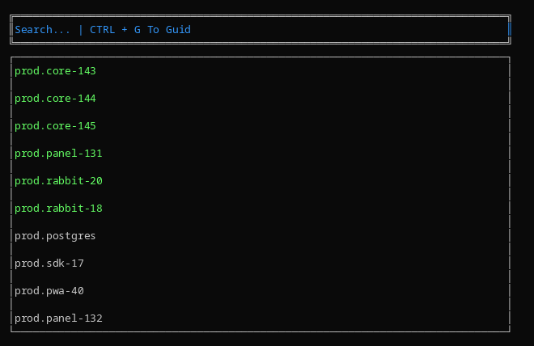

# ssht

[](https://github.com/shabane/ssht/actions/workflows/ci.yml)
[](https://github.com/shabane/ssht/releases)
[](https://opensource.org/licenses/MIT)


**ssht** or **ssh-tmux**.
As a DevOps engineer, every day I used to
open a *tmux*, create many *panes*, and in each pane *ssh*
to a host, then set `synchronize-panes on` to run commands across all
panes at once.

Then I became familiar with the [sshs](https://terminaltrove.com/feed/sshs/)
tool — a great TUI over the
[*ssh_config*](https://man.freebsd.org/cgi/man.cgi?query=ssh_config&sektion=5&manpath=OpenBSD+3.4) file that lets you
search and connect to your SSH hosts.

I combined these two ideas into **`ssht`**, a fast and intuitive TUI that lets you search through your SSH hosts,
optionally multi-select specific servers with `Space`, and connect to one or batch-open them
in a tmux session (or connect directly without tmux).

### Features
- **Inline Command Autocomplete & Ghost-Text Placeholder:** inline cyan/blue ghost text suggestions in `:` mode (k9s-style), with `Tab` cycling through commands/tags and `Right Arrow` to accept
- **Vim-Style Directional Navigation:** home-row navigation (`j`/`k` Up/Down, `h`/`l` Left/Right, `g`/`G` Top/Bottom of list, and `j`/`k`/`h` in modals)
- **K9s-Style Navigation:** single-key actions when focused on list (`d` describe, `e` edit in editor, `s` shell, `w` direct, `c` remote command, `/` search, `:` command mode)
- **Host Inspection Modal (`d`):** inspect all `ssh_config` directives (IdentityFile validation, ProxyJump, LocalForward, RemoteCommand, Tags, and file location)
- **In-Place Config Editing (`e`):** jump straight to the host's definition line in `$EDITOR` (vim, nano, code) and auto-reload changes upon exit
- **Advanced Query & Tag Filtering:** filter by tags (`#tag`, `tag:name`, `:tag name`), colon directives (`:proxy`, `:fwd`, `:badkeys`, `:cmd`, `:all`), or inverted matches (`!term`)
- **Fast Search:** case-insensitive substring match across host aliases, configured IPs, users, tags, and ProxyJump bastions
- **Multi-Selection:** toggle selection on hosts with `Space` to open only chosen servers
- **Smart Sorting:** sort with `CTRL+S` (selected & reachable hosts float to top, unreachable to bottom)
- **Batch Tmux Sessions:** open in tiled panes (`CTRL+A` or `a`), synchronized panes (`CTRL+O` or `o`), or separate windows (`CTRL+N`)
- **Direct Connect:** connect to a single host directly without tmux (`Enter`, `s`, or `CTRL+W` / `w`)
- **Remote Tmux Connect:** connect to a single host running tmux directly on the server (`CTRL+T` or `t`)
- **Informative List:** displays each host's configured user and IP (`[user@]HostName`) next to its alias
- **ProxyJump / Bastion Support:** detects proxy/bastion configs, labels them `[proxy]`, and avoids false unreachable alerts
- **Full `Include` Support:** recursively parses `Include` directives with wildcards and relative paths
- **Live Reachability Check:** concurrent TCP pinger (up to 22 hosts in parallel) with green/red status coloring
- **CLI Options:** custom config file via `-c / --config` and optional `--no-ping` flag
- **Bottom Status Bar:** always-visible shortcuts guide with live selection counter

### Usage & CLI Options
```text
ssht [options]

Options:
  -c, --config <path>   Path to custom SSH config file (default: ~/.ssh/config)
      --no-ping         Disable reachability ping checks
  -v, --version         Show ssht version
  -h, --help            Show help message
```

### Installation
To install or update to the latest version of `ssht`, run the following command in your terminal:
```bash
curl -sSL https://raw.githubusercontent.com/shabane/ssht/master/install.sh | bash
```
This script will automatically detect your OS/architecture, download the correct latest release from GitHub, and install it to `~/.local/bin/ssht`.

### Shortcuts
|     Key      |                       Task                       |
|:------------:|:------------------------------------------------:|
| Enter / `s`  | Open Selected Host in Tmux                       |
|    `d`       | Describe / Inspect host SSH config directives    |
|    `e`       | Edit host definition line directly in `$EDITOR`  |
|    `w`       | Direct Connect (No Tmux)                         |
|    `t`       | Connect with Remote Tmux                         |
|    `c`       | Run configured `RemoteCommand` (if defined)      |
|    `a`       | Open Filtered/Selected Hosts in Tailed Tmux      |
|    `o`       | Open Filtered/Selected Hosts With Synced Panes   |
|    `:`       | Command prompt mode (`:tag`, `:proxy`, `:fwd`...) |
|    `/`       | Quick search / filter mode (`#tag`, `tag:...`)   |
|    Space     | Toggle selection of host ([x])                   |
|     Tab      | Switch focus / Cycle `:` command completions      |
|    Right     | Accept inline ghost-text suggestion in `:` mode   |
| `j` / `k` (↑/↓) | Navigate host list Up / Down (or scroll modal)  |
| `h` / `l` (←/→) | Scroll host list Left / Right (`h` closes modal) |
|  `g` / `G`   | Jump to Top / Bottom of host list                |
|   PgUp/Dn    | Page up/down in host list                        |
|    CTRL+S    | Sort hosts (Selected & Reachable first)          |
|    CTRL+W    | Connect Directly to Selected Host (No Tmux)      |
|    CTRL+T    | Connect to Selected Host with Remote Tmux        |
|    CTRL+A    | Open Filtered/Selected Hosts in Tailed Tmux      |
|    CTRL+O    | Open Filtered/Selected Hosts With Synced Panes   |
|    CTRL+N    | Open Filtered/Selected Hosts In New Windows      |
|    CTRL+G    | Open Guide Menu                                  |
|     Esc      | Reset search / close modal / back                |
|    CTRL+C    | Quit                                             |

### Command Palette (`:` Commands)
Press `:` from the host list to enter command mode. Typing displays an inline ghost-text placeholder (cyan `#38bdf8`) with suggestions. Press `Tab` to cycle through matches or `Right Arrow` to accept:

| Command | Action |
|:-------:|:-------|
| `:q`, `:quit` | Exit `ssht` cleanly |
| `:r`, `:reload` | Re-read `~/.ssh/config` from disk and auto-refresh hosts without restarting |
| `:h`, `:help` | Open guide and keybindings menu |
| `:ping` | Trigger an immediate concurrent reachability ping |
| `:select all` | Select all visible hosts (`[x]`) for batch tmux actions |
| `:select <query>` | Select visible hosts matching query (e.g. `:select prod`) |
| `:clear` | Clear all selections |
| `:sort name` | Sort visible hosts alphabetically by alias |
| `:sort ip` | Sort visible hosts by resolved IP address |
| `:sort status` | Sort hosts by status (selected & reachable first, unreachable last) |
| `:proxy` | Filter view to hosts using `ProxyJump` or `ProxyCommand` |
| `:fwd`, `:tunnel` | Filter view to hosts with `LocalForward` or `DynamicForward` |
| `:badkeys` | Filter view to hosts with missing or insecure identity files |
| `:keys` | Filter view to hosts with an explicit `IdentityFile` |
| `:cmd` | Filter view to hosts with a configured `RemoteCommand` |
| `:tag <name>` | Filter view to hosts matching specified tag |
| `:all` | Reset all view filters and restore all hosts |

### Demos

#### 1. Connect to Single Host (Press `Enter` / `CTRL+W` for Direct / `CTRL+T` for Remote Tmux)


#### 2. Connect to All (Tailed Mode - `CTRL+A`)


#### 3. Connect to All with Synced Panes (`CTRL+O`)


#### 4. Connect to All in New Windows (`CTRL+N`)


#### Building from Source
```bash
git clone https://github.com/shabane/ssht.git
cd ssht
go build -o ssht .
```

---

> I guarantee that it works on my machine.